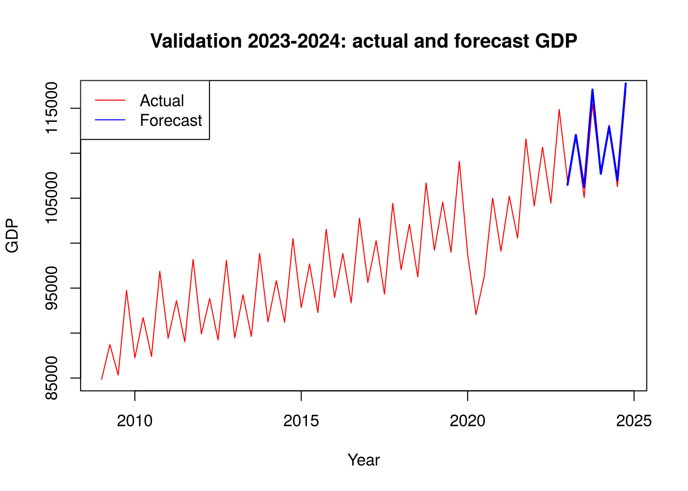
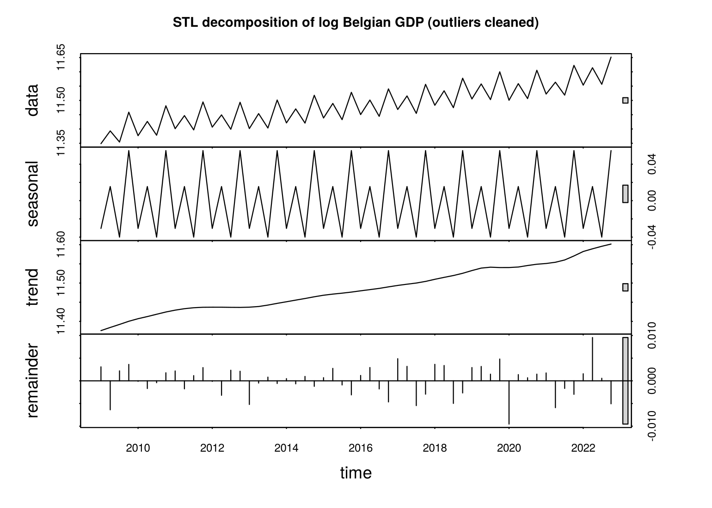
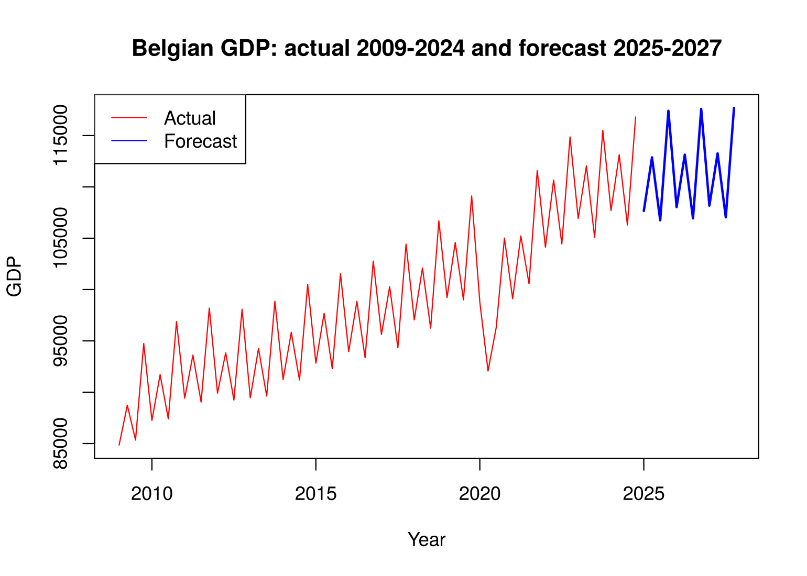

# Forecasting Belgian GDP

Quarterly Belgian GDP is forecast with a decomposition approach: the series is split into trend, seasonal, and remainder components, each component is forecast separately, and the pieces are added back together. The project then tests whether the GDP of Germany, France, or the Netherlands improves the forecast, and produces a forecast for 2025–2027.

Main results:

- Forecasting the trend with exponential smoothing instead of a linear regression cut the validation error by more than half (SMAPE from 1.35% to 0.56%).
- All three neighboring economies Granger-cause Belgian GDP, but none of them improved the out-of-sample forecast. The final model uses Belgian data only.



## Data

Quarterly GDP for Belgium, Germany, France, and the Netherlands from FRED (https://fred.stlouisfed.org), stored in `gdp_quarterly.xlsx`. Each country has its own date and value column (`Date_BE`, `GDP_BE`, and so on), because the series start in different years.

The analysis uses 2009 Q1 – 2022 Q4 for estimation and holds out 2023 Q1 – 2024 Q4 (eight quarters) for validation. The final model is refit on 2009 Q1 – 2024 Q4.

## Method

1. Exploration. The raw series has a clear upward trend, quarterly seasonality, and variance that changes over time. The ACF decays slowly, the KPSS test rejects stationarity, and the ADF test finds a unit root unless a trend term is included.

2. Structural break. After removing a linear trend and seasonal indices from the 1995–2022 series, the residuals behave differently before and after 2008–2009: a trend remains before, a seasonal pattern after. The 2008 crisis appears to have changed the dynamics of the series, so the analysis starts in 2009. From here on, the model works with log GDP.

3. COVID. The COVID quarters can be treated either as outliers or as a new structural break. I treat them as outliers, because from about 2022 the series returns to its pre-2020 trend and seasonal amplitude, unlike after 2008. Each COVID quarter (2020 Q2 – 2021 Q1 for Belgium) is replaced by the average of the same quarter in the other years, and the trend is re-estimated on the cleaned series.

4. Decomposition. A linear trend with fixed seasonal indices left clearly autocorrelated residuals. An STL decomposition (`stl`, LOESS-based) captured the nonlinear trend better, and its remainder is stationary by the ADF test.

   

5. Remainder model. The correlograms of the STL remainder point to at most an ARMA(2,2). Among the candidate models, AIC and BIC both select ARMA(0,2); `auto.arima` suggested an empty model. The ARMA(0,2) residuals pass the Ljung–Box test (p = 0.90 at 20 lags), and the McLeod–Li test shows no ARCH/GARCH effects.

6. Forecast. Each component is forecast separately and the results are added and transformed back from logs:
   - remainder: ARMA(0,2);
   - seasonal: the last year's seasonal pattern, repeated;
   - trend: first a linear regression, then exponential smoothing (`forecast()`, which fits an ETS model). The ETS trend did much better.

7. Exogenous variables. The four GDP series are cointegrated (Johansen test: two cointegrating vectors). With a lag order of 4, chosen by giving equal weight to the information criteria from `VARselect`, German, French, and Dutch GDP each Granger-cause Belgian GDP. Each country's series then goes through the same cleaning and decomposition, its remainder is modeled and forecast with its own ARMA model, and the forecast remainder enters the Belgian remainder model as an exogenous regressor.

## Results

Validation error (SMAPE) on 2023 Q1 – 2024 Q4:

| Model | SMAPE |
|---|---:|
| Linear trend forecast | 0.01353 |
| ETS trend forecast, no exogenous variable | 0.005643 |
| ETS trend, with German GDP | 0.005644 |
| ETS trend, with French GDP | 0.005645 |
| ETS trend, with Dutch GDP | 0.006138 |

Switching the trend forecast to exponential smoothing mattered most. The models with German or French GDP are practically identical to the model without an exogenous variable, and Dutch GDP made the forecast worse. Granger causality is an in-sample property, and here it did not translate into better out-of-sample forecasts. With only eight validation quarters, differences in the sixth decimal place should not be read as meaningful.

The final model, without exogenous variables and refit on 2009–2024, gives the following forecast:



| Year | Q1 | Q2 | Q3 | Q4 |
|---|---:|---:|---:|---:|
| 2025 | 107,659.5 | 112,875.3 | 106,749.0 | 117,412.8 |
| 2026 | 108,034.3 | 113,137.9 | 106,934.7 | 117,589.9 |
| 2027 | 108,175.6 | 113,266.2 | 107,040.0 | 117,690.3 |

Values are in the units of the FRED source series.

## Repository structure

| File | Purpose |
|---|---|
| `gdp_forecast.Rmd` | The full analysis, with commentary |
| `gdp_forecast.html` | The rendered report |
| `gdp_quarterly.xlsx` | Quarterly GDP for the four countries |
| `figures/` | Figures used in this README, written by the report when rendered |

## How to run

Requirements: R 4.x with the packages

```r
install.packages(c("readxl", "ggplot2", "dplyr", "tseries", "aTSA", "forecast",
                   "TSA", "astsa", "lmtest", "urca", "vars", "tsDyn", "rmarkdown"))
```

Then, from the repository folder:

```r
rmarkdown::render("gdp_forecast.Rmd")
```

## Limitations

- The validation window is only eight quarters, so the comparison between models rests on very few observations.
- Treating COVID as a set of outliers rather than a structural break is a judgment call. Both choices are defensible, and they lead to different forecasts.
- The seasonal forecast repeats the last year's pattern, which assumes the seasonality stays fixed.
- The forecasts are point forecasts. The report does not compute prediction intervals.
